<p align="center">
  
</p>

<p align="center">
  <a href="https://github.com/9LEVEL/lvl9/actions/workflows/test.yml"></a>
  <a href="https://github.com/9LEVEL/lvl9/releases"></a>
  
  
  <a href="LICENSE"></a>
</p>

<p align="center">
  <a href="#-instalar"><b>Instalar</b></a> ·
  <a href="#-o-prompt"><b>Prompt</b></a> ·
  <a href="#%EF%B8%8F-nada-para-decorar-alth"><b>Alt+H</b></a> ·
  <a href="#-o-que-vem-instalado"><b>O que vem</b></a> ·
  <a href="#-como-funciona"><b>Como funciona</b></a> ·
  <a href="#-perguntas-frequentes"><b>FAQ</b></a>
</p>

---

O **lvl9** pega um Debian ou Ubuntu recém-instalado com XFCE e deixa a máquina pronta para
trabalhar, no estilo do [Omarchy](https://github.com/basecamp/omarchy) e do setup do
[Fábio Akita](https://github.com/akitaonrails). Você ganha um prompt powerline com git, IP e relógio,
a CLI moderna escrita em Rust e Go, o vim com o tema halcyon, tmux, Nerd Fonts, flameshot no
PrintScreen, xrdp redondo e, se quiser, Claude Code com statusbar e herdr.

São uma linha no terminal e uma tela de instalação. **Sem flags e sem nada para decorar.**

## ⚡ Instalar

```bash
curl -fsSL https://raw.githubusercontent.com/9LEVEL/lvl9/main/boot.sh | bash
```

Rode como **o seu usuário**, não como root. O lvl9 pede a senha do sudo uma vez e configura
**o seu usuário e o root**. Em uma máquina nova leva de 5 a 10 minutos, e pode rodar de novo
quando quiser: cada passo só mexe no que mudou e guarda backup do que substitui.

<p align="center">
  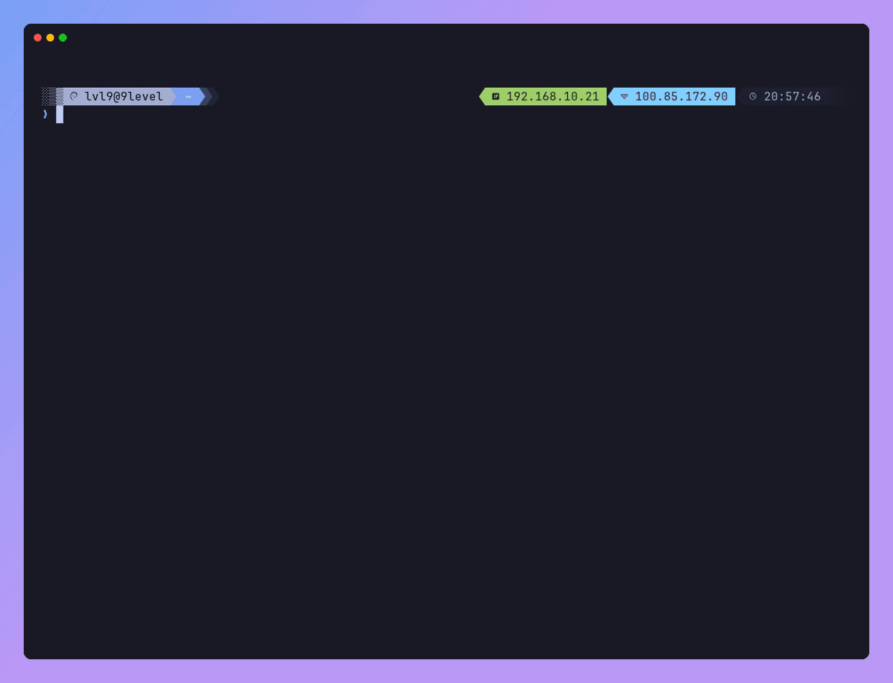
</p>

<table>
  <tr>
    <td width="50%">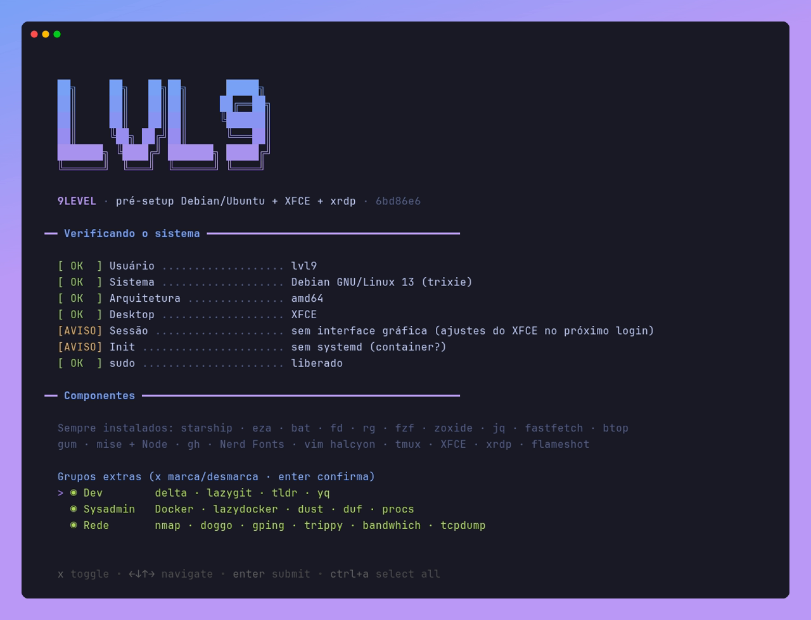</td>
    <td width="50%">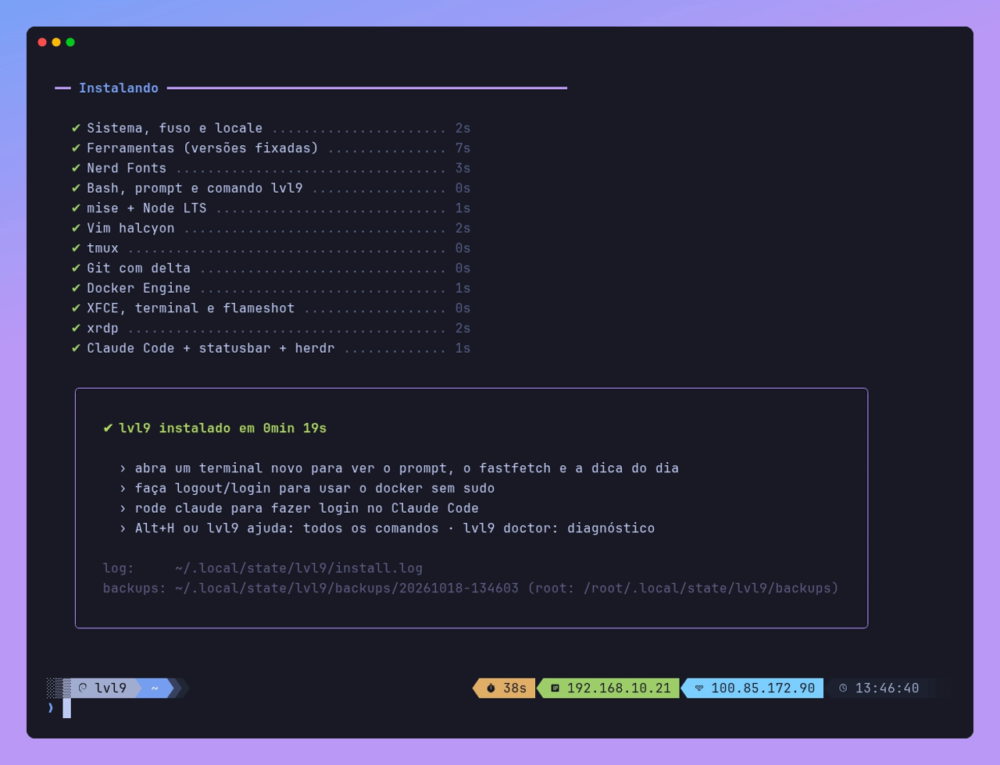</td>
  </tr>
  <tr>
    <td align="center"><sub>Escolhas na tela: <code>x</code> marca, <code>Enter</code> confirma</sub></td>
    <td align="center"><sub>Cada passo com tempo e resumo no final</sub></td>
  </tr>
</table>

## 🎨 O prompt

Duas linhas: à esquerda o que você está fazendo, à direita onde e quando.

<p align="center">
  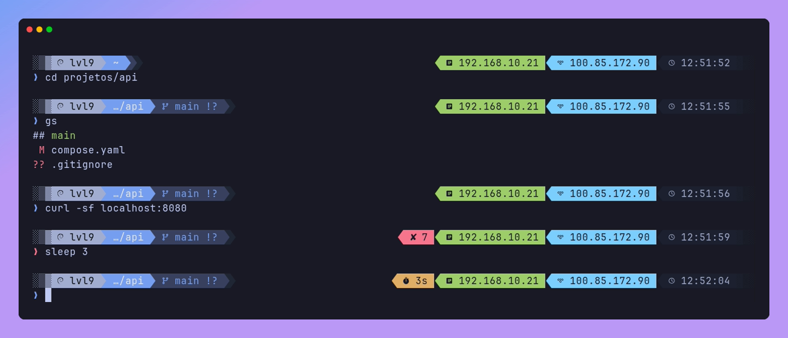
</p>

- **Git**: branch e estado (`!` modificado, `?` novo).
- **Erro e duração**: o código de saída aparece só quando o comando falha, e o tempo só quando passa de 2s.
- **IP da LAN e do Tailscale**: o da LAN vem da interface da rota padrão (nunca do `docker0`), e o do
  Tailscale da faixa `100.64.0.0/10`. A detecção roda 1x por dia, para não pesar no Enter. Mudou de
  rede? `atualiza-ip`.
- **Relógio** no fim da linha, para saber a hora em que cada comando rodou.

**Cinco temas.** Para ver todos com a sua pasta atual, rode `lvl9 tema`. Para trocar, `lvl9 tema <nome>`.

<p align="center">
  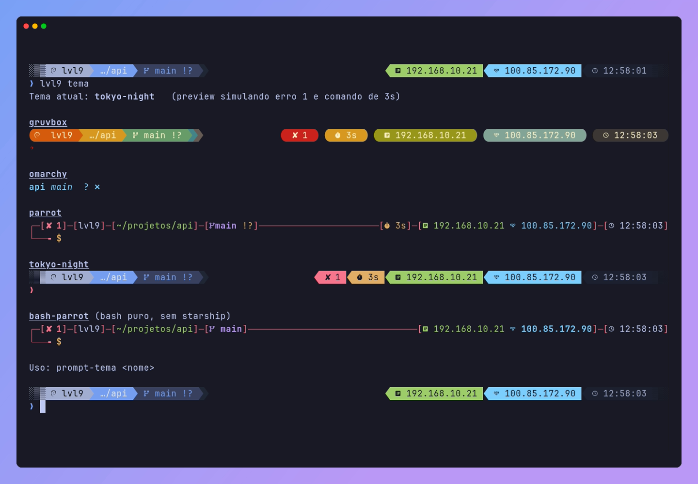
</p>

## 🖥️ Ao abrir o terminal

Um resumo do sistema com o fastfetch e uma dica de comando, diferente a cada terminal. Se cansar,
desligue com `lvl9 fastfetch off` ou `lvl9 dicas off`.

<p align="center">
  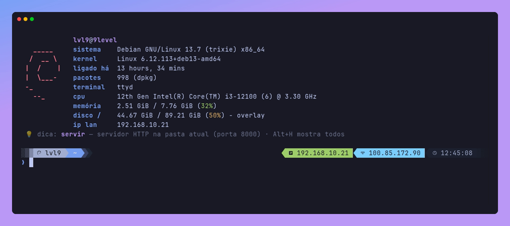
</p>

## ⌨️ Nada para decorar: Alt+H

**`Alt+H`**, a qualquer momento, abre o catálogo de comandos com busca. O comando escolhido vai
para o prompt, pronto para você editar ou rodar.

<p align="center">
  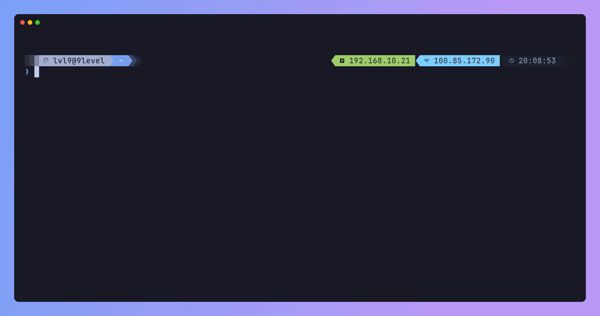
</p>

Todo comando novo tem nome em **inglês e em pt-BR**:

| inglês | pt-BR | o que faz |
|---|---|---|
| `sys` | `sistema` | resumo do sistema (fastfetch) |
| `disk` | `disco` | espaço livre em cada disco (duf) |
| `usage` | `pasta` | o que está ocupando espaço aqui (dust) |
| `proc` | `processos` | processos com cores e busca (procs) |
| `ports` | `portas` | portas abertas e quem está ouvindo |
| `monitor` | `monitorar` | CPU, memória, disco e rede (btop) |
| `lg` · `lzd` | | git e Docker numa interface no terminal (lazygit, lazydocker) |
| `dns` | | consulta DNS moderna (doggo) |
| `pingg` | `pingar` | ping com gráfico, vários hosts (gping) |
| `route` · `bw` | `rota` · `banda` | traceroute visual (trippy) · banda por processo (bandwhich) |
| `scan` | `varrer` | nmap rápido das 100 portas mais comuns |
| `examples` | `exemplos` | exemplos práticos de um comando (tldr, em português) |
| `update` | `atualizar` | atualiza todos os pacotes do sistema |

Os comandos de sempre também ficam melhores, **sem mudar de nome**: `ls` (eza, com ícones e git),
`cat` (bat, com cores), `top` (btop), `cd` (zoxide, pula para a pasta mais usada) e `Ctrl+R` (fzf).

<p align="center">
  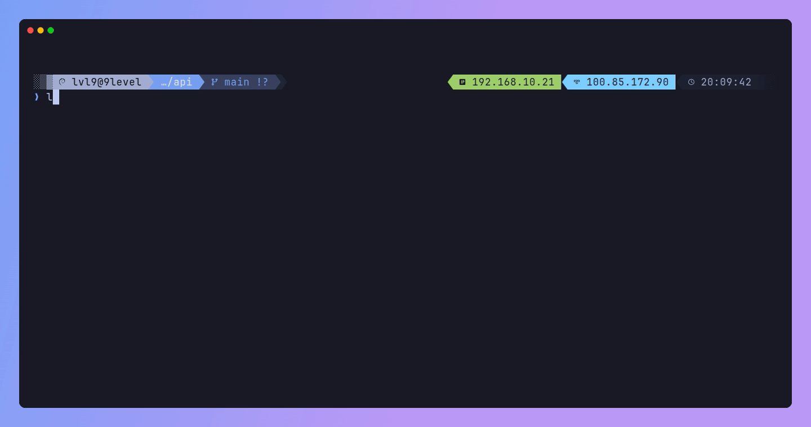
</p>

## 📝 Vim com halcyon

O [halcyon-vim](https://github.com/julianol1berato/halcyon-vim) com vim-plug, airline, NERDTree
(`Espaço f`), coc.nvim, ALE, fugitive e `:FZF` (`Ctrl+P`). Fica igual no seu usuário e no root.

<p align="center">
  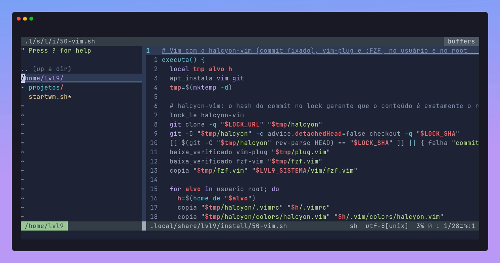
</p>

## 🤖 Claude Code

Marque **Claude Code** na instalação e ele vem completo, no seu usuário e no root:

- **[Claude Code](https://docs.claude.com/en/docs/claude-code)** pelo instalador oficial, que se atualiza sozinho.
- **[statusbar-claude](https://github.com/9LEVEL/statusbar-claude)** mostra contexto usado, limites de 5h e da semana, custo e modelo.
- **[herdr](https://herdr.dev)** organiza vários agentes em painéis, já integrado ao Claude Code.

<p align="center">
  
</p>

## 📦 O que vem instalado

| | |
|---|---|
| **Sempre** | starship · eza · bat · fd · ripgrep · fzf · zoxide · jq · fastfetch · btop · gum · gh · mise com Node LTS |
| **Dev** | delta (diff do git lado a lado) · lazygit · tldr · yq |
| **Sysadmin** | Docker Engine · lazydocker · dust · duf · procs |
| **Rede** | nmap · doggo · gping · trippy · bandwhich · tcpdump · socat · mtr |
| **Shell** | bash no estilo do Akita, prompt com 5 temas, aliases em inglês e pt-BR, `Alt+H`, fastfetch e dica ao abrir |
| **Editor e terminal** | vim halcyon · tmux Tokyo Night (prefixo `Ctrl+a`) · JetBrainsMono e CaskaydiaMono Nerd Font |
| **Desktop** | XFCE · xfce4-terminal com Nerd Font e Tokyo Night · flameshot em `Print` e `Super+Shift+S` |
| **xrdp** | sessão XFCE · som pelo RDP · sem o pedido de senha do colord a cada login |
| **Sistema** | fuso America/Sao_Paulo com NTP · locale pt_BR.UTF-8 |
| **Opcional** | Tailscale · Claude Code + statusbar-claude + herdr |

Os grupos **Dev**, **Sysadmin** e **Rede** vêm marcados. Desmarque na tela o que não quiser.

## 🩺 Depois de instalado

```
lvl9 update      busca a versão nova e reaplica, com as suas escolhas de antes
lvl9 diff        mostra o que mudou na máquina em relação ao lvl9
lvl9 doctor      confere cada ferramenta contra a versão fixada
lvl9 tema        mostra ou troca o tema do prompt
lvl9 dicas on|off · lvl9 fastfetch on|off
```

<details>
<summary><b>Ver o <code>lvl9 doctor</code></b></summary>
<br>
<p align="center">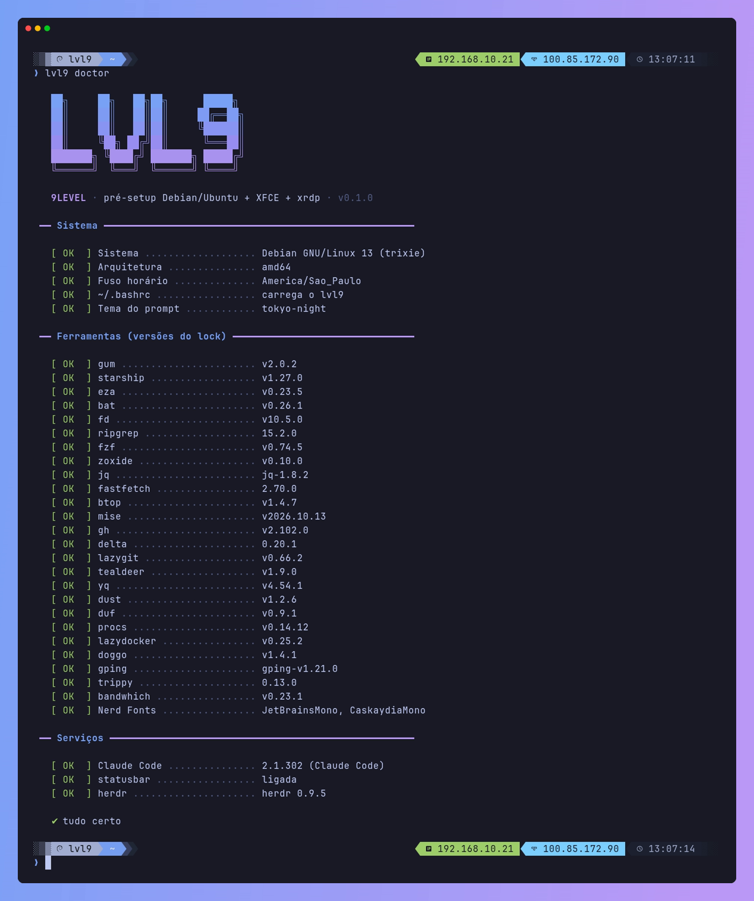</p>
</details>

## 🔒 Como funciona

- **Versões fixadas e conferidas.** Cada binário vem do GitHub na versão do
  [`versions.lock`](versions.lock), com sha256. Se o download não bater, a instalação para. Toda
  semana, um GitHub Action procura versões novas, confere com os checksums publicados pelos
  projetos e abre um pull request. Depois do merge, `lvl9 update` traz as novidades.
  Claude Code, herdr e Tailscale usam os instaladores oficiais, que conferem o próprio download e
  se atualizam sozinhos.
- **O root nunca lê configuração de um home.** Temas do starship podem executar comandos, então o
  prompt, os temas e os aliases ficam em `/usr/local/share/lvl9`, que só o root altera.
- **Cópia com backup, não symlink.** Tudo o que é substituído vai antes para
  `~/.local/state/lvl9/backups/<data>/`. Os arquivos do root vão para `/root/.local/state/lvl9/backups/`.
- **O seu `~/.bashrc` é seu.** Ele só carrega `/usr/local/share/lvl9/bash/rc`. O `lvl9 update`
  atualiza o rc e não mexe mais no seu `~/.bashrc`. Segredos ficam em `~/.bashrc.local`.
- **XFCE na hora certa.** Instalou de dentro da sessão gráfica? Fonte, cores e atalhos são
  aplicados na hora. Instalou por SSH? São aplicados sozinhos no próximo login.
- **Testado de verdade.** Cada mudança instala o lvl9 inteiro em containers limpos de Debian 12 e
  13 e Ubuntu 24.04 e 26.04, e confere 84 itens em cada um.

## ❓ Perguntas frequentes

<details>
<summary><b>Posso rodar de novo?</b></summary>
<br>
Pode, quantas vezes quiser. A tela já vem com as suas escolhas anteriores, e cada passo só mexe no
que mudou. É o que o <code>lvl9 update</code> faz por baixo.
</details>

<details>
<summary><b>Como desfaço uma mudança?</b></summary>
<br>
Tudo o que foi substituído está em <code>~/.local/state/lvl9/backups/&lt;data&gt;/</code>, com a mesma
árvore de pastas do original. Para voltar o <code>~/.bashrc</code> de antes:
<code>cp ~/.local/state/lvl9/backups/&lt;data&gt;/home/$USER/.bashrc ~/</code>.
</details>

<details>
<summary><b>Os ícones do prompt aparecem como quadrados.</b></summary>
<br>
O terminal precisa de uma Nerd Font. No xfce4-terminal o lvl9 já configura a JetBrainsMono. Se você
acessa por SSH a partir de outro computador (Windows Terminal, iTerm2…), instale uma
<a href="https://www.nerdfonts.com/font-downloads">Nerd Font</a> nesse computador e selecione-a no terminal dele.
</details>

<details>
<summary><b>O PrintScreen não abre o flameshot pelo RDP.</b></summary>
<br>
O Windows costuma segurar o PrintScreen, e a tecla nem chega à sessão. Use <code>Super+Shift+S</code>,
que o lvl9 também configura, ou desligue em <i>Configurações → Acessibilidade → Teclado → Usar a tecla
Print Screen para abrir a captura de tela</i>.
</details>

<details>
<summary><b>Funciona em servidor sem interface gráfica?</b></summary>
<br>
O lvl9 é pensado para desktop: ele instala XFCE e xrdp se não houver. A parte de terminal (prompt,
CLI, vim, tmux) é a mesma, mas por enquanto não existe um modo "só servidor".
</details>

<details>
<summary><b>Estrutura do repositório</b></summary>
<br>

```
boot.sh              alvo do curl | bash: valida, clona em ~/.local/share/lvl9 e abre o instalador
install.sh           a tela: verificações, escolhas, passos e resumo
install/NN-*.sh      passos idempotentes (sistema, ferramentas, fontes, shell, vim, docker, xrdp…)
lib/                 comum.sh (lock, downloads, cópia com backup) · ui.sh (gum) · desktop.sh (xfconf)
config/              rc do bash, prompt, temas, catálogo de comandos, tmux, fastfetch, xfce, xrdp
bin/lvl9             o comando lvl9
ferramentas.tsv      o que é instalado e de onde vem
versions.lock        versões e sha256 (gerado por tools/bump-versions.sh)
tests/               instalação completa em containers limpos: tests/docker.sh [imagem…]
docs/                banner, cenas das screenshots (docs/tapes) e imagens (docs/img)
tools/               bump-versions.sh · screenshots.sh · banner.py
```
</details>

## 🤝 Contribuir

```bash
tests/docker.sh                 # instala nas 4 distros em containers limpos e confere tudo
tests/docker.sh ubuntu:24.04    # só uma
tools/screenshots.sh            # regrava as imagens deste README (tudo em Docker)
tools/bump-versions.sh          # atualiza o versions.lock com as últimas versões
```

Issues e pull requests são bem-vindos.

## Créditos

Inspirado no [Omarchy](https://github.com/basecamp/omarchy) e no setup do
[Fábio Akita](https://github.com/akitaonrails). Interface do instalador feita com o
[gum](https://github.com/charmbracelet/gum). Tema do vim:
[halcyon-vim](https://github.com/julianol1berato/halcyon-vim). Statusbar do Claude Code:
[statusbar-claude](https://github.com/9LEVEL/statusbar-claude).

<p align="center">
  <sub>MIT · feito por <a href="https://github.com/9LEVEL">9LEVEL</a></sub>
</p>
